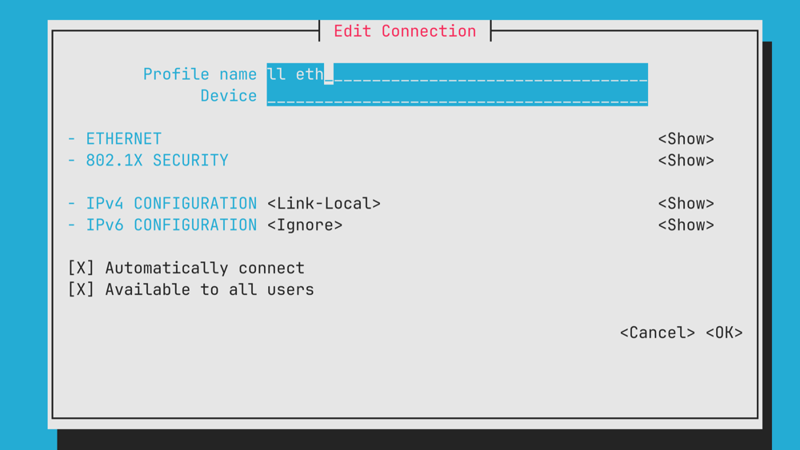

+++
title = "Link-Local Connection to Raspberry Pi"
date = "2025-02-24T15:34:59-05:00"
+++

*This is a living document; content will be updated as necessary (after the initial post date).*

I needed to have a Ethernet connection from my laptop to a Raspberry Pi without any extra hardware (e.g. a router).
Turns out this isn't as smooth as I expected (especially with NetworkManager), so the following is a list of steps to get it working.

## On The Raspberry Pi

Make a new connection profile that uses Link-Local configuration for IPv4.
You can either do this using the `nmtui` terminal interface, or through `nmcli`:

```sh
nmcli connection add type ethernet con-name "Link-Local Ethernet" ifname eth0 ipv4.method link-local ipv6.method ignore autoconnect yes
```

Note: If you're running the Pi headless, you should specify `autoconnect yes`, so NetworkManager retries without any interaction.



Make sure there are no other (competing) Ethernet connections (or they have a lower priority) (`nmcli connection | grep -E 'TYPE|ethernet'` or by using the TUI).
If there are, you can either delete them with `nmcli connection delete <name>` or change their priority with `nmcli connection modify <name> connection.autoconnect-priority <priority>`.

## On A Linux Laptop

Make a new connection profile that uses Link-Local configuration for IPv4.
Essentially, we do the same but our make sure you have the correct Ethernet interface: `ifconfig` should list all interfaces the device has.
If you're using a USB-C-to-Ethernet adapter, try plugging it into different USB ports.
In my case, the USB port that the adapter works in is not idempotent (!).

## On a Mac

Make sure to unplug and other Ethernet cables.
Then, plug in the Ethernet cable to the Raspberry Pi and your Mac.
macOS should prompt you to connect to the new network.

If it doesn't work, make sure there aren't any other network connections that are interfering:
go to `Network Settings` → `Other Services` and delete ones that you aren't using at this moment.
If you're prompted to "re-add on connection," you can click either option.

The same troubleshooting tip for Linux applies: try plugging it in again, and make sure to try other Ethernet ports!
